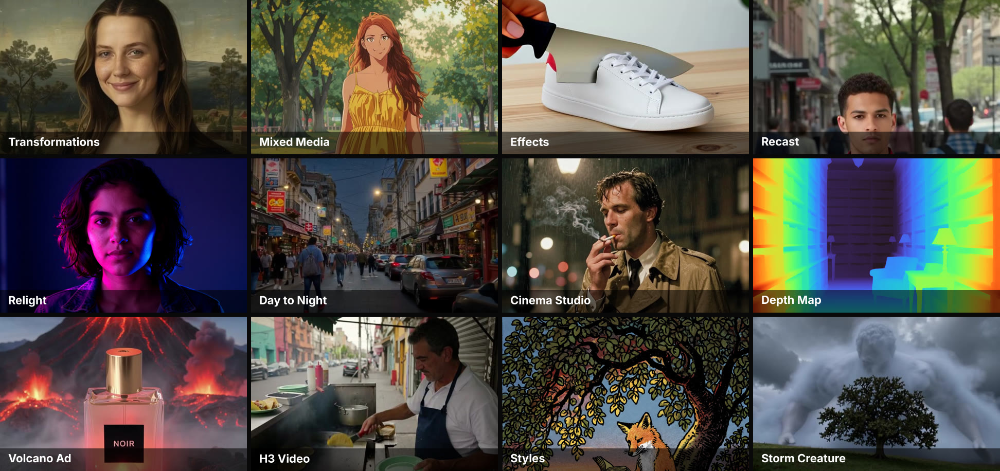
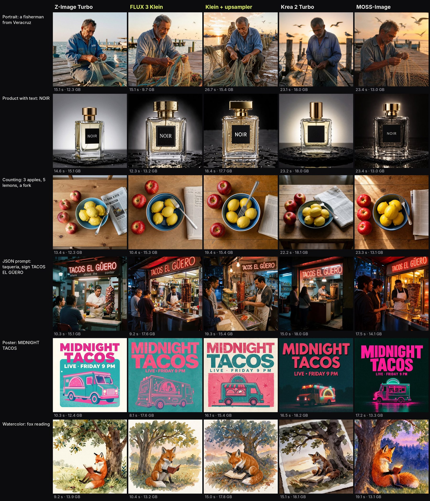

# Freefield

Open-source Higgsfield on ComfyUI: every app is one folder, every model is open weights.



Freefield rebuilds Higgsfield's creative apps (image, video, VFX, audio) on top of ComfyUI and the Comfy SDK.
There is no per-app code. Each app is a folder in `apps/` with an `app.json` manifest and a ComfyUI workflow in API
format; the web UI, the runner, the model downloads, the VRAM map and the tests are all derived from those manifests.

```
browser ──▶ web/ + server/ (Node, Comfy SDK) ──▶ gateway :8000 ──▶ comfy-api-proxy :8189 ──▶ ComfyUI :8188
             menu and forms drawn                 token check,          Comfy API v2              your GPU
             from apps/*/app.json                 unloads the GPU       in front of ComfyUI       (Modal or local)
                                                  when the app changes
```

[Run it](#run-it) on Modal or on your own ComfyUI · [every app](#apps) with its model and VRAM · [add an app](#add-an-app) from any ComfyUI workflow · [every GPU run](docs/lab-runs.md) of the lab

## Status

| | |
|---|---|
| Apps | 120: 119 *ready* (39 apps with a workflow of their own, the 5 IC-LoRA apps (`genjutsu`, `reframe`, `sdr-hdr`, `mixed-media`, `dub`), `morph`, 72 template apps (a fixed prompt over one of those pipelines, written by `tools/template_apps.py`) and 2 model-free smoke apps) and `moss-image` as a draft. The 118 that use models each have a lab example made on a GPU |
| Open weights | No API or partner nodes. Every model is a file you download, listed in its app's `app.json` with its Hugging Face repo, size and license; the cloud text-encoder branch of Lightricks' examples is removed |
| Workflows | Built from official sources by `tools/build_apps.py` (ComfyUI's templates, Lightricks' ComfyUI-LTXVideo examples, Comfy's `comfy-reshoot`); the template apps reuse those bases and the two smoke apps are hand-written. `tools/import_workflow.py` drafts a new app from any other ComfyUI workflow. All accepted by ComfyUI's validator: ComfyUI `e3bee7f` (0.42.0), ComfyUI-LTXVideo `44c8a36`, ComfyUI-CrossViewWarp `fbb1e93` |
| GPU runs | 48 lab runs on Modal from 20 to 26 Oct (L40S and H100), 710 of 733 cases ok. Every example in the web UI comes from one of them, with its time and peak VRAM. Run by run, and what each one changed: [`docs/lab-runs.md`](docs/lab-runs.md) |
| End to end | Run from the browser on 23 Oct, web UI → server → gateway on Modal → ComfyUI on an H100: `morph` 160.8 s from the button to the video (128.7 s of it on the GPU), `mixed-media` 149 s, `dub` 72 s. On 24 Oct through the hosted demo (`infra/web_app.py`, the same web app on Modal behind a passcode): `face-swap` 25.2 s on the GPU. The model-free smoke apps cover the same path in CI |
| LoRA lab | 334 cases with fixed seeds: one showcase per app (117), 42 references the other cases start from, and experiments, each with its verdict in its note: every effect, look of `mixed-media` and transformation of `morph` on its own, the character types of `ai-influencer`, the image-model comparison (`cmp-*`, below), template and style-drift tests (`tplx-*`, `mmx-*`), `reshoot` without its Turbo LoRA, the soundtrack candidates for the demo video and checks of new controls. How the lab works: [below](#the-lora-lab-and-the-gallery) |
| CI | `.github/workflows/validate.yml` on every push: the manifest validator, the tests, the type check, the generated packs and VRAM map, and a CPU-only ComfyUI that accepts every workflow and the prompt of every lab case (about 3 minutes) |

## Apps

| App | Rebuilds | Model | On a 24 GB card | Status |
|---|---|---|---|---|
| `create-image` | Create Image | FLUX 3 Image Klein (int8) + BFL's 9B prompt upsampler (an on/off toggle): 10 aspect ratios, 1K to 2K, 17 photographic looks; a layout table in JSON can follow the prompt | fits whole, 17.8 GB | ready |
| `z-image` | Create Image, fast drafts | Z-Image Turbo (int8); the lab makes its reference photos with it | fits whole, 12.2 GB | ready |
| `moss-image` | Create Image with a layout | MOSS-Image SFT (int8), Apache-2.0; also takes a layout JSON with a box per text and object | fits whole, 13.0 GB | draft |
| `styles` | Image styles | Krea 2 Turbo (int8) + Krea's nine official style LoRAs, picked from a list | fits whole, 19.4 GB | ready |
| `style-reference` | Style transfer | Krea 2 Turbo (int8) + style-reference LoRA | fits whole, 19.4 GB | ready |
| `cinema-studio` | Cinematic Cameras | FLUX 3 Image Klein + genre, era, camera body, lens, focal length, aperture, lighting and color palette, written as the look they give; 6 aspect ratios, 1K to 2K | fits whole, 11.0 GB | ready |
| `cinema-video` | Cinema Studio (video) | Cinema Studio's still (FLUX 3 Image Klein) as the first frame of LTX-2.5 image-to-video in one graph: the same look selects plus up to 3 camera moves from Higgsfield's list of 33, written in the order picked (one move holds; the lab found the order of two is not reliable), tempo and duration; sound included | needs Modal, peak 44.3 GB on L40S | ready |
| `edit` | Edit | FLUX 3 Image Klein (int8): a change described in words, no mask | fits whole, 11.0 GB | ready |
| `inpaint` | Inpaint | FLUX 3 Image Klein with a noise mask: paint the area in the web UI's brush and only that area is redrawn, then pasted back over the photo | fits whole, 11.0 GB | ready |
| `relight` | Relight | Qwen Image Edit 2509 (fp8) + Relight and Lightning LoRAs: light presets, or direction, softness, brightness and color | tight: 21.5 GB largest phase | ready |
| `upscale`, `upscale-video` | Upscale | SeedVR2 3B (int8) | fits whole, 4.0 GB | ready |
| `remove-bg` | Background removal | BiRefNet | fits whole, 0.4 GB | ready |
| `video-remove-bg` | Remove Background (video), Video Background Remover | BiRefNet on every frame: the clip over a solid color with its sound, plus the matte | fits whole, 0.4 GB | ready |
| `depth-map` | Depth Map | MoGe-2: a depth map (colored or grayscale) or a normal map of a photo | fits whole, 0.7 GB | ready |
| `smooth` | Slow motion / smoothing | FILM frame interpolation | fits whole, 0.1 GB | ready |
| `video`, `video-t2v` | Create Video (with audio) | LTX-2.5 22B distilled (int8) | tight: 21.5 GB largest phase | ready |
| `h3-video`, `h3-photo` | Create Video (with audio) | MiniMax H3 (int8) from Comfy's templates: text or a photo to a clip with speech, sound and music, 20 steps, no turbo LoRA | needs Modal: 27.1 GB text encoder | ready |
| `extend-video` | Extend Video | MiniMax H3 from the clip's last frame, the new part joined after it with its sound | needs Modal: 27.1 GB text encoder | ready |
| `vfx-clean-plate`, `vfx-day-to-night`, `vfx-water` | VFX | LTX-2.5 + official IC-LoRAs | tight: 21.8–22.4 GB | ready |
| `transitions` | Effects / Transitions | LTX-2.5 + transition LoRA (2.3) | tight: 21.9 GB | ready |
| `camera-moves` | Camera Controls | Wan 2.2 Fun Camera (fp8): pans, zooms and rolls on an image, with a 4-step fast preset | fits by phases, 15.3 GB | ready |
| `camera-copy` | Camera Controls | LTX-2.5 + Cameraman v2 IC-LoRA (2.3): copies the camera move of a reference clip | tight: 22.1 GB | ready |
| `genjutsu` | Genjutsu | LTX-2.5 + Ingredients IC-LoRA: one reference sheet (people, props, a place side by side) composed into a clip | tight: 22.8 GB largest phase | ready |
| `reframe` | Reframe | LTX-2.5 + In-Outpainting IC-LoRA (2.3), two stages: a new aspect ratio with the missing parts painted in | tight: 22.8 GB largest phase | ready |
| `sdr-hdr` | SDR to HDR | LTX-2.5 + SDR-to-HDR IC-LoRA and its scene embeddings (no text encoder): a 10-bit HLG master plus a tone-mapped preview | tight: 22.8 GB largest phase | ready |
| `mixed-media` | Mixed Media | FLUX 3 Klein redraws the clip's first frame in one of 16 looks, then LTX-2.5 + Union Control IC-LoRA (2.3), two stages, follows it with the clip's edges (core Canny) as structure | tight: 22.1 GB largest phase | ready |
| `morph` | Effects (transformations) | FLUX 3 Klein redraws the photo as the transformation (15: Renaissance portrait, red carpet, younger self, clones, cartoon, statue, old age, astronaut, knight, assassin, baby, bride, classy, princess, robot face reveal) and LTX-2.5 + the transition LoRA morphs the photo into it: the face stays (all 15 ran on an H100, 23 Oct) | tight: 21.9 GB largest phase | ready |
| `dub` | Lipsync Studio (dub) | LTX-2.5 + DubIt IC-LoRA (2.3): new words in the prompt, the clip as guide and its audio as the speaker reference; Lightricks' DubIt workflow exists only for 2.3, this is a port | needs Modal: 24.0 GB denoise phase (the LoRA is 2.5 GB) | ready |
| `effects` | Effects | Wan 2.1 image-to-video 14B (fp8) + 24 effect LoRAs, 20 of them by Remade-AI (Cakeify, Hydraulic press, Money rain, 360° orbit…): the physical, camera and expression effects, picked from a gallery, with a 6-step fast preset | fits by phases, 16.8 GB | ready |
| `music` | Audio | MiniMax Music 3 | fits whole, 14.3 GB | ready |
| `sfx` | Audio | Stable Audio 3 medium | fits whole, 10.4 GB | ready |
| `recast` | Character swap | SCAIL-2 (int8) + SAM 3.1 tracking: replace a person in a video, or animate a character | fits by phases, 18.6 GB | ready |
| `motion-transfer` | Character / motion swap | Wan Animate 2 (int8) | fits by phases, 16.6 GB | ready |
| `reshoot` | Camera angles | MiniMax H3 + MoGe + CrossView: a clip seen from a new angle, the holes of the reprojection filled in | needs Modal: 27.1 GB text encoder (ran on a 48 GB L40S, peak 44.2 GB) | ready |
| `product-shot` | Product placement | FLUX 3 Image Klein (int8) with product-photography scenes | fits whole, 11.0 GB | ready |
| `speak` | Speak | LTX-2.5 image-to-video voicing a quoted line (voice, lip sync and motion in one pass, no TTS) | tight: 21.5 GB largest phase | ready |
| `character` | Soul ID | FLUX 3 Image Klein, reference image (int8) | fits whole, 11.0 GB | ready |
| `character-3` | Soul ID | FLUX 3 Image Klein with three photos of one person as references (no training) | fits whole, 11.0 GB | ready |
| `moodboard` | Soul Moodboard | FLUX 3 Image Klein: three reference images give the look (palette, light, grain), the prompt the subject | fits whole, 11.0 GB | ready |
| `photodump` | Photodump | FLUX 3 Image Klein four times over one photo: four scenes of an aesthetic, each with its own framing, in one run | fits whole, 11.0 GB | ready |
| `talking` | Lipsync / Speak | LTX-2.5 audio-to-video (int8) | tight: 21.5 GB largest phase | ready |
| `smoke`, `smoke-invert` | — | none | — | ready |

### Which image model

Create Image ran on Z-Image Turbo until 24 Oct. Artificial Analysis' text-to-image arena (October 2026) ranks FLUX 3
Image Klein first among open-weights models (1043 Elo; Qwen-Image-2.1 1042, Bria's Fibo 2.0 1039, Krea 2 up to 1034)
and Z-Image Turbo at 936, and Klein is the file the edit apps already download. The lab ran six prompts on five
models with the same seed (run `20261024-230058-l40s`, below): Klein kept the counts (three apples, five lemons) where
Z-Image drew four apples, wrote the label Krea 2 left blank, kept the top-down view Krea missed, and read a JSON prompt
as a scene where Z-Image printed its keys on the sign. So `create-image`, `cinema-studio`, `ai-influencer` and `meme`
run on Klein. BFL's 9B upsampler is a toggle in Create Image (on by default: it turns a short prompt into a full
caption, about 8 s more). Z-Image stays for fast drafts and for the lab's reference photos, so earlier examples keep
their inputs. MOSS-Image (Apache-2.0) is in as a draft for layout prompts. Fibo 2.0, trained on JSON prompts, needs a
newer ComfyUI than the one pinned here and its weights are licensed for non-commercial use only.



### Soul ID without training

Higgsfield's Soul ID trains a model of a person from their photos. Freefield does not train: `character` (one photo)
and `character-3` (three photos) copy the person from the references on every run, 13.0 s of L40S time in the lab
(about $0.007 at Modal's base price of $1.95 an hour). A character LoRA keeps a GPU busy for tens of minutes instead
(an estimate, not measured here: 30 minutes of H100 at $3.95 an hour is about $2 per person), the hosted demo would
bill that to its owner's Modal account, and a LoRA of someone's face has to be stored per user and with their consent,
which a demo without user accounts cannot do. So training is left for later, and the path uses ComfyUI 0.42's own
nodes: an app that takes 10 to 20 photos of one person → `VAEEncode` → `TrainLoraNode` on FLUX 3 Image Klein →
`SaveLoRA` to the Modal volume, then `character` loads it with `LoraModelLoader`. Still to check: whether
`TrainLoraNode` trains on the int8 Klein file Freefield downloads (5.83 GB) or needs the full weights.

### Template apps

Higgsfield's catalog is mostly fixed prompts over a few pipelines, and so is this: each of these apps is one of
Freefield's pipelines with its prompt baked in, selects that fill parts of it, and an "Extra direction" box appended
to it. The bases: `edit` (FLUX 3 Image Klein, one reference image), `edit` with a second reference (a garment, another
person; for `face-swap`, MediaPipe's face oval from core ComfyUI nodes masks the edit and the face photo is Klein's only
reference; for `expand-image`, the photo gets a border that only Klein draws), `create-image` without its upsampler (Klein text to image), `video`
(LTX-2.5 image-to-video with its own audio), `morph` (Klein draws the last frame from a fixed instruction, LTX-2.5
and the transition LoRA move the photo into it), `effects`' Wan 2.1 pipeline with one effect LoRA fixed (joyfox's
Bullet Time; for `bullet-time-white` and `-splash`, Klein redraws the photo first) and `relight`'s
Qwen-Image-Edit-2509 pipeline with another LoRA (dx8152's Multiple Angles for `angles`, `shots` and `zooms`; lovis93's
next-scene v2 for `whats-next`). `tools/template_apps.py` holds the table and writes the 71 folders (manifest + the
base workflow, with the few edits a base needs) and their lab cases; `--readme` prints this list and `--lab` the
command that makes every example. Add a line to the table there, not a folder by hand.

| App | Rebuilds | Base | Inputs |
|---|---|---|---|
| `poster` | Poster | `edit` | product photo, headline |
| `packshot` | Packshot | `edit` | product photo, backdrop |
| `macro-scene` | Macroshot Scene | `edit` | product photo, setting |
| `macro-product` | Macroshot Product | `edit` | product photo |
| `giant-product` | Giant Product | `edit` | product photo, time of day |
| `billboard` | Billboard Ad | `edit` | your photo, where |
| `graffiti-ad` | Graffiti Ad | `edit` | product photo |
| `fridge-ad` | Fridge Ad | `edit` | product photo |
| `ugc-shot` | Marketing (UGC) | `edit` | product photo, where |
| `headshot` | AI Headshot Generator | `edit` | your selfie, backdrop, outfit |
| `commercial-faces` | Commercial Faces | `edit` | your photo, campaign |
| `style-snap` | Style Snap | `edit` | your photo, style |
| `skin-enhancer` | Skin Enhancer | `edit` | your photo |
| `outfit-vending` | Outfit Vending Machine | `edit` | your photo |
| `glitter-sticker` | Glitter Sticker | `edit` | your photo |
| `game-styles` | Game Dump | `edit` | your photo, game style |
| `plushie` | Plushies | `edit` | your photo |
| `render-3d` | 3D Render | `edit` | your photo |
| `figure-3d` | 3D Figure | `edit` | your photo |
| `pixel-game` | Pixel Game | `edit` | your photo |
| `brick-toy` | Brick Cube | `edit` | your photo |
| `sketch-to-real` | Sketch-to-Real | `edit` | your sketch |
| `paint-app` | Paint App | `edit` | your photo |
| `mural` | Signboard | `edit` | your photo |
| `micro-beasts` | Surrounded by Animals | `edit` | your photo, animals |
| `meme` | Meme Generator | `create-image` | scene, top text, bottom text |
| `j-magazine` | J-Magazine | `edit` | your photo |
| `cafe-60s` | 60s Cafe | `edit` | your photo |
| `victory-card` | Victory Card | `edit` | your photo |
| `j-poster` | J-Poster | `edit` | your photo |
| `mascot` | Mascot | `edit` | your photo, mascot |
| `burning-sunset` | Burning Sunset | `edit` | your photo |
| `comic-book` | Comic Book | `edit` | your photo |
| `giallo` | Giallo Horror | `edit` | your photo |
| `renaissance` | Renaissance | `edit` | your photo |
| `japanese-show` | Japanese Show | `edit` | your photo |
| `breakdown` | Breakdown | `edit` | your photo |
| `edit-text` | Edit Text | `edit` | image with text, text to replace, new text |
| `image-effects` | Image Effects | `edit` | your photo, effect |
| `color-grade` | Color Grading | `edit` | your photo, look |
| `fashion-factory` | Fashion Factory | `edit` | your photo, garment photo, scene |
| `try-on` | AI Stylist | `edit` | your photo, garment photo |
| `outfit-swap` | Outfit Swap | `edit` | your photo, photo of the outfit |
| `outfit-shot` | Outfit Shot | `edit` | model photo, garment photo, pose |
| `character-swap` | Character Swap | `edit` | scene photo, photo of the new person |
| `face-swap` | Face Swap | `edit` | photo to edit, photo of the face |
| `behind-the-scenes` | Behind the Scenes | `video` | your photo |
| `asmr-product` | ASMR Add-On | `video` | product photo |
| `asmr-whisper` | ASMR Classic | `video` | your photo |
| `asmr-host` | ASMR Host | `video` | your photo |
| `chameleon` | Chameleon | `morph` | product photo, product colors |
| `magic-button` | Magic button | `video` | product photo |
| `truck-ad` | Truck Ad | `video` | product photo |
| `kick-ad` | Kick Ad | `video` | product photo |
| `volcano-ad` | Volcano Ad | `morph` | product photo |
| `roller-coaster` | Roller Coaster | `morph` | your photo |
| `storm-creature` | Storm Creature | `video` | your photo |
| `cloud-surf` | Cloud Surf | `morph` | your photo |
| `mukbang` | Mukbang | `video` | your photo |
| `melting-doodle` | Melting Doodle | `video` | your photo |
| `rap-video` | Rap God | `video` | your photo |
| `idol` | Idol | `video` | your photo |
| `expand-image` | Expand Image | `edit` | your photo, expand |
| `ai-influencer` | AI Influencer | `create-image` | character type, gender, age, origin, skin tone, build, height, proportions, hairstyle, hair color, head shape, neck, eye shape, eye color, facial features, facial hair, distinctive traits, style, accessories, scene |
| `ai-influencer-photo` | AI Influencer (your photo) | `edit` | your photo, hairstyle, hair color, build, facial hair, facial features, distinctive traits, style, accessories, scene |
| `bullet-time-scene` | Bullet Time Scene | `effects` | your photo, who or what is in the photo |
| `bullet-time-white` | Bullet Time White | `edit + effects` | your photo, who or what is in the photo |
| `bullet-time-splash` | Bullet Time Splash | `edit + effects` | your photo, who or what is in the photo |
| `angles` | Angles 2.0 | `relight + Qwen-Edit-2509-Multiple-angles` | your photo, camera move |
| `shots` | Shots | `relight + Qwen-Edit-2509-Multiple-angles` | your photo, shot |
| `zooms` | Zooms | `relight + Qwen-Edit-2509-Multiple-angles` | your photo, zoom |
| `whats-next` | What's Next? | `relight + next-scene-qwen-image-lora-2509` | your photo, continuation |

The sizes above are weights only. Full table, with the peak VRAM measured on each app's lab example and the GPU it ran
on: [`docs/vram-map.md`](docs/vram-map.md) (`python tools/catalog.py vram`). Between two apps with different base
models the gateway calls ComfyUI's `POST /free`, so nothing from the previous app stays in VRAM.

## Run it

You need Node 22.6+, Python 3.10+ and a [Modal](https://modal.com) account.

```sh
# 0. what is missing: Node, Modal login and secrets, Hugging Face license access per model, .env
python tools/doctor.py

# 1. secrets (once). Pick the Modal workspace first: in .env, FREEFIELD_MODAL_PROFILE=<profile from `modal profile list`>
python tools/setup_token.py                       # gateway token: Modal secret "freefield" and .env get the same value
modal secret create huggingface HF_TOKEN=hf_...   # accept the gated licenses on the Hub first (doctor.py checks them)

# 2. models into the "freefield-models" volume, per pack (see packs/index.json)
python tools/catalog.py packs
modal run infra/modal_app.py::download --pack image

# 3. backend (private: it needs the token)
modal deploy infra/modal_app.py                   # FREEFIELD_GPU=A10G to try the 24 GB plan

# 4. web app
npm install
# in .env (made by step 1): COMFY_BASE_URL = the URL printed by step 3
npm run serve                                     # http://127.0.0.1:3000
npm run app -- create-image --set prompt="a red bicycle against a white wall"   # or from the terminal
```

On Windows PowerShell, environment variables go before the command as `$env:FREEFIELD_GPU = "A10G"; modal deploy ...`.

### The web app

`npm run serve` opens a studio laid out like the one it rebuilds:

- **Explore**: featured apps as video cards, the studios, and one lab example per app.
- Pointing at **Image**, **Video** or **Audio** in the top bar opens a menu with every app of that studio, grouped as
  in the studio, and a column with the open models behind them and how many apps use each.
- **Image** and **Audio**: prompt-first apps. Results fill the page and a floating bar holds the prompt, reference
  images (click **+**, drop or paste them), one chip per setting, the number of generations and **Generate**, which shows
  how long the lab example took on the GPU.
- **Video** (and the upload-first tools): controls in a left column (*Create video*, *Edit video*, *Motion control*),
  results on the right.
- Every app has **History** (what you generated with it), **Library** (the lab example, *Load this example*) and
  **How it works** (models and licenses, VRAM by phase, the download and terminal commands, and *Download the
  workflow*: drop it on ComfyUI's canvas to open the app as nodes and chain it with others).
- A select marked `multiple` takes up to a few options at once and sends them in the order picked (Cinema Studio
  Video's camera moves are numbered; AI Influencer's facial features, distinctive traits and accessories). Apps that
  list each other under `modes` show a switch at the top of the form: *Image / Video* in Cinema Studio, *New character
  / Your photo* in AI Influencer.
- **Use in…** on any image or video result (in History and in the viewer) puts the file into another app and opens
  it: the usual next steps first (Image to Video, Motion Transfer, Relight, Upscale…), then every app that takes it.
- An image input marked `paint` in `app.json` (`inpaint`) opens a brush over the photo it names: what you paint becomes
  a white-on-black mask the size of the photo (`web/js/paint.js`).
- A thumbs-down on any lab example (Explore, Library, the viewer, the effects picker) marks it *mediocre*. The marks
  live in `lab/flags.json` (key `<app>` or `<app>/<input>/<option>`), **Library → Lab examples → Mediocre** lists them,
  and `lab/publish.py` clears a mark when a new run replaces that example. It is how a reviewer tells the lab which
  results need a better model, LoRA or prompt.
- **Apps** lists every app by category; **Library** shows everything you generated; **VRAM map** draws each app's
  weights, largest phase and measured peak against 24 and 48 GB.
- **Compare** (on any result) puts it next to another file side by side, or as a wipe for two images; videos play in
  sync. Drop the result of the same prompt from Higgsfield, or anything else; dropped files never leave the browser.
- The **GPU** pill says whether the backend is warm (asking never wakes it) and wakes it on request, so a cold start
  happens while you prepare the inputs. When warm it shows the VRAM in use and which app is loaded.
- English or Spanish (the globe button); it follows the browser until you pick one.

Runs are recorded before they are submitted and kept in `out/history/<id>/` (inputs, outputs and a `meta.json` with
the values, the seed that was used, and timings), so they survive a closed tab, the backend's retention and a server
restart; runs still going when the server stops are picked up again. *Recreate* puts any result's inputs and settings
back in the form.

### A private link to the studio

To let someone else use your Freefield (a reviewer, a friend) without installing anything, the same web app runs on
Modal next to the backend, behind a passcode:

```sh
python tools/setup_demo.py            # once: a passcode → Modal secret "freefield-demo" and .env
modal deploy infra/web_app.py         # the web UI on a small CPU container that scales to zero
python tools/setup_demo.py --link     # the link to share: https://<workspace>--freefield-demo.modal.run/?key=…
```

The link sets the passcode as a cookie; without it every page and API call gets a passcode page. Runs are capped at
30 a day (UTC) and 2 at a time, so a shared link cannot run up the GPU bill (`FREEFIELD_MAX_RUNS_PER_DAY` and
`FREEFIELD_MAX_ACTIVE` at deploy time change that); the GPU pill shows how many are left. Lab marks are read-only
there, uploads stop at 100 MB, and the history lives in the `freefield-web` volume. Running `setup_demo.py` again
changes the passcode and locks out the old link once you redeploy.

Any ComfyUI works as the backend: run `comfy-api-proxy` next to it and `python infra/gateway.py` in front, and point
`COMFY_BASE_URL` at the gateway. Pointing it straight at a `comfy-api-proxy` (or another Comfy API v2 endpoint) works
too; only the unload-between-apps step is skipped. An app marked `draft` (none is, today) stays locked in the UI and
the CLI until you set `FREEFIELD_DRAFTS=1` (or pass `--draft` to `npm run app`).

## The LoRA lab and the gallery

`lab/cases.json` lists experiments: reference images, clips and a song are generated first, then every app and LoRA
runs on them with a fixed seed. Each app has a *showcase* case, so one command makes an example of every app:

```sh
modal run --detach lab/lab_modal.py --showcase    # one example per app + the references they need (139 cases)
modal run lab/lab_modal.py --pull <run_id>        # only if the terminal closed before the end: copy back and publish
```

The effects app has one case per effect (`fx-*`, 24 of them, on synthetic people, objects and scenes made
by `z-image` in the same run). Its effect picker is a *gallery* input, so `lab/publish.py` also keeps one example per
effect (`web/examples/effects/options/`): the picker shows them as cards and *Explore* gets a wall of effects. A run
of a few effects adds to that gallery without replacing the rest.

```sh
modal run --detach lab/lab_modal.py --apps effects --shards 4   # 24 effects + their 19 reference stills, on 4 GPUs at once
modal run lab/lab_modal.py --only fx-cakeify,fx-squish          # re-run a few after changing their prompt
modal run lab/lab_modal.py --only tplx-*                        # a pattern works too (fnmatch)
```

`--shards N` works with any selection: it splits the cases over N GPU containers that run at the same time, keeping
the cases that read the same reference together so each reference is made once (the 24 effects become 4 groups of
6). The GPU time stays about the same, plus loading the models once per container; the wait drops to about 1/N.
The groups write to `<run_id>-s1`, `-s2`… on the volume and come back merged into one `lab/results/<run_id>`, with one
`review.html`; `--pull <run_id>` merges them the same way.

Runs can also come from a queue, so that someone working on the repo (an assistant included) can ask for a run
without waiting for you to type it. You start the watcher once, in a terminal where `modal` is logged in:

```sh
python tools/lab_queue.py            # watches lab/queue/; Ctrl+C stops it, a file lab/queue/STOP pauses it
```

A job is a file `lab/queue/<name>.job.json` such as `{"only": "tpl-face-swap,tplx-face-swap-*", "note": "why"}`. The
watcher runs exactly `modal run lab/lab_modal.py --only <only>` (plus `--shards N` if the job asks, up to 4), one job
at a time, saves the output to `<name>.log` and writes `<name>.done.json` with the exit code, the run id and the
"N/M ok" line. It accepts nothing else: no deploy, no other command, only case ids and patterns that exist in
`lab/cases.json`, at most 60 cases per job and 12 jobs a day (`--max-cases`, `--max-jobs`); a job outside that gets a
`<name>.refused.json` with the reason. Your Modal login never leaves your machine.

`--detach` keeps the GPU job running if the terminal closes; the run id is printed at the start. Missing models are
downloaded first on a CPU container, so no GPU is billed while they arrive (the whole catalog is
104 files, about 355 GB). Then one GPU container runs the cases, recording time and peak VRAM, and keeps going when one fails;
a case whose model could not be downloaded (say, a license not yet accepted) is skipped with the reason. Every output
also gets small web versions (a card, a poster for videos, a web-sized copy). At the end the run is copied to
`lab/results/<run_id>`, `review.html` is built there for rating, and `lab/publish.py` copies one example per app into
`web/examples/` (its output plus the reference files it was given): the web UI uses it as the app's card and video
loop, in *Explore*, in each app's *Library* tab, and for *Load this example*, which puts the same inputs and settings in
the form so you can run it again and compare.

```sh
modal run lab/lab_modal.py                        # every case (LoRA comparisons included) on an L40S
modal run lab/lab_modal.py --apps camera-moves,relight   # only these apps (their reference cases come along)
FREEFIELD_GPU=A10G modal run lab/lab_modal.py --only ic-clean-plate    # 24 GB parity check
python lab/publish.py lab/results/<run_id>        # republish examples from a run you already have
python lab/review.py lab/results/<run_id> --apply-peaks   # measured VRAM into each app.json
python tools/comfy_validate.py --comfy-dir /path/to/ComfyUI --placeholders --lab lab/cases.json   # free, CPU: every case's prompt is valid
```

## Add an app

1. Get the workflow in API format: add a recipe to `tools/build_apps.py` (official template + explicit edits), or
   export it from ComfyUI with *Export (API)*. A fixed prompt over a pipeline that already runs is one line in
   `tools/template_apps.py` instead (see *Template apps* above). For any other workflow, `tools/import_workflow.py`
   writes the first draft of steps 1 and 2 (see below).
2. Write `apps/<id>/app.json`: inputs and where each one binds (`node` + `field`), outputs, and every model with its
   Hugging Face repo, size and phase. The schema is `schema/app.schema.json`. A `select` option can carry `sets`
   (extra node fields written when it is chosen, like the LoRA file that goes with a style); a string in `sets` may
   use `{input_id}` placeholders like a bind template (each effect writes its LoRA's prompt, with its trigger words, around
   your `{subject}`). `presets` change several fields at once (the 4-step mode of `camera-moves`), and a select marked
   `"gallery": true` is shown as cards with one lab example per option.
3. Check it:
   ```sh
   npm run validate                                # schema, bindings, declared models vs. loaders
   bash tools/ci_comfyui.sh /tmp/comfyui           # once: CPU ComfyUI at the pinned commit + pinned custom nodes
   python tools/comfy_validate.py --comfy-dir /tmp/comfyui --placeholders
   python tools/catalog.py all                     # packs and VRAM map
   npm test
   ```

### From any ComfyUI workflow

```sh
python tools/import_workflow.py my_workflow.json --id my-app --name "My App"   # API or UI format
```

It reads the graph and writes `apps/my-app/app.json` + `workflow.api.json` as a draft: the image, video and audio
loaders become inputs, the positive prompt, seed, steps, size and titled primitives become fields, every `Save…` node
an output, and every loader file a model, with its Hugging Face repo, size and license when `packs/` already knows the
file. Then it runs the validator on the new app and prints what to check by hand. Details and limits:
[`docs/import-workflow.md`](docs/import-workflow.md).

`tools/comfy_validate.py` creates empty model files and tiny inputs so ComfyUI's own validator can check a workflow on
any machine, CPU included. `tools/ui2api.py` converts UI workflows (with subgraphs and dynamic widgets) to API format
using the node definitions in `tools/object_info.json`.

## Credits and licenses

Code: MIT. Model weights are not in this repository and keep their own licenses, listed in each `app.json`
(Apache-2.0, MIT, OpenRAIL, LTX-2.x Community License, FLUX Kommunity License, Krea 2 Community License, SAM License,
Stable Audio Community License, MiniMax H3 Community License). Some community LoRAs are research-only or non-commercial
(Cameraman v2 in `camera-copy`), and one states no license on its model card (lightx2v's MiniMax-H3 Turbo in `reshoot`;
its code repository is Apache-2.0); their `app.json` says so and the web UI shows it next to the model. Workflows are adapted from ComfyUI's official templates, Lightricks' ComfyUI-LTXVideo examples and Comfy-Org's comfy-reshoot (MIT);
the cloud text-encoder branch in Lightricks' examples is removed so every app runs on open weights only. Camera and
lens vocabulary in `cinema-studio` comes from [open-higgsfield-ai](https://github.com/sunnychase/open-higgsfield-ai) (MIT).
LoRAs outside `effects`: Lightricks' IC-LoRAs (LTX-2.x Community License); joyfox's LTX-2.3 transition LoRA (`transitions`,
`morph` and the four templates on it), dx8152's Multiple Angles and lightx2v's Qwen-Image Lightning (Apache-2.0); lovis93's
next-scene v2 (MIT); elix3r's talking-head LoRA in `talking` (OpenRAIL); Cseti's CrossView Warp in `reshoot` (MiniMax H3
Community License). `face-swap` masks the face with Comfy-Org's MediaPipe face landmarker (Apache-2.0).
20 of the 24 effect LoRAs in `effects` are [Remade-AI](https://huggingface.co/Remade-AI)'s; the other 4 are by
[joyfox](https://huggingface.co/joyfox) (Bullet time, Money rain; its repos moved there from valiantcat and laozou),
[ostris](https://huggingface.co/ostris) (Dolly zoom) and
[lvfengchun](https://huggingface.co/lvfengchun) (Steam from nose and ears), all Apache-2.0. Each effect's prompt follows the
example on its model card and keeps its trigger words. Nine of Remade-AI's image-to-video LoRAs are left out: the ones that undress someone, fire a gun, make two
people kiss, or put a franchise character or a religious figure on screen. Four more came out wrong in three lab rounds (Painting,
Pirate captain, Zen, Crash zoom out) and four were taken out to keep the app SFW (Jungle, Samurai, Warrior, Jumpscare); Remade-AI's
Dolly effect and Bullet time were replaced. joyfox's smoke outfit change and gothic transformation LoRAs worked in the lab but were
left out for the same reason: the first dresses people in the outfits of its examples (a bunny suit with a corset, a tight dress,
a school uniform), the second puts gloved hands from someone unseen on the person's shoulders.

Use footage and characters you own or have permission for; the apps are meant for SFW work.
